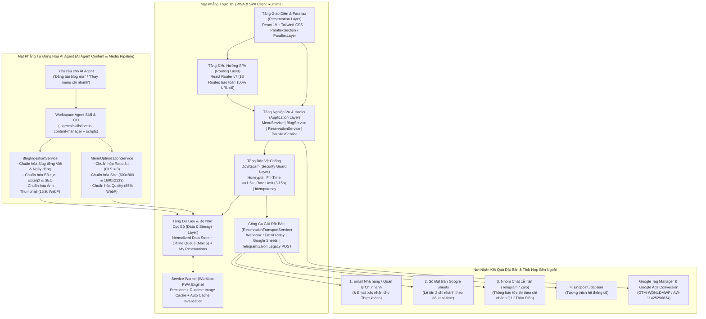
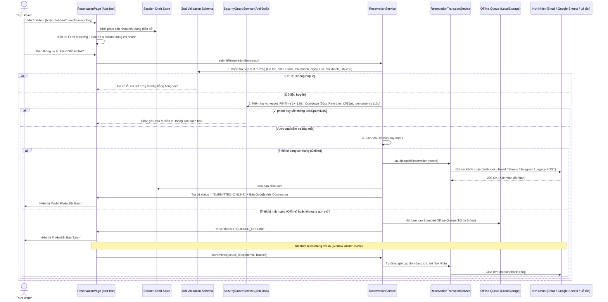

# System Architecture Document (SA) — Nhà Hàng Lạc Thái Webapp (SPA & PWA)

- **Mã tài liệu:** `DOC-SA-LACTHAI`
- **Phiên bản SA:** `1.3.0` (Đồng bộ với `DOC-BR-LACTHAI v1.3.0`)
- **Ngày cập nhật:** `2026-10-17`
- **Trạng thái:** `DRAFT v1.3.0 — Đã bổ sung Kiến trúc Chi tiết Tính năng Đặt bàn (Công cụ gửi & Nơi nhận kết quả)`

---

## 1. Lịch Sử Phiên Bản & Đồng Bộ BR ↔ SA (Version Synchronization Log)

> **Quy tắc bắt buộc:** Mỗi khi `docs/BR.md` được cập nhật, tài liệu `docs/SA.md` này phải được cập nhật ngay lập tức và mọi quyết định kiến trúc phát sinh phải được lưu vết tại `docs/adr/`.

| Phiên bản SA | Phiên bản BR tham chiếu | Ngày | Nội dung cập nhật kiến trúc | ADR liên quan |
| :--- | :--- | :--- | :--- | :--- |
| `1.0.0` | `1.0.0` | 2026-10-17 | Thiết kế kiến trúc nền tảng SPA & PWA đầu tiên đáp ứng 100% yêu cầu từ `BR v1.0.0` (FR-01 đến FR-08, NFR-01 đến NFR-05). | `ADR-001` .. `ADR-005` |
| `1.1.0` | `1.1.0` | 2026-10-17 | 1. Bổ sung **Kiến trúc Parallax Scrolling Đa Tầng (`ParallaxService`, `useParallax`, `ParallaxSection`, `ParallaxLayer`)** đạt 60fps (`NFR-03`, `FR-02`, `FR-03`, `FR-05`).<br>2. Bổ sung **Kiến trúc Phòng chống DoS/DDoS & Anti-Spam 4 lớp (`SecurityGuardService`)** (`FR-06`, `NFR-06`). | `ADR-003 v1.1.0`, `ADR-004 v1.1.0`, `ADR-006`, `ADR-007` |
| `1.2.0` | `1.2.0` | 2026-10-17 | Bổ sung **Kiến trúc Tự động hóa cho AI Agent (`AI Agent Content & Media Ingestion Pipeline`)** gồm `BlogIngestionService` và `MenuOptimizationService` (`FR-09`, `FR-10`, `NFR-07`). | `ADR-004 v1.2.0`, `ADR-008` |
| `1.3.0` | `1.3.0` | 2026-10-17 | Bổ sung **Mục 4: Kiến Trúc Chi Tiết Hệ Thống Đặt Bàn Trực Tuyến (`End-to-End Reservation Architecture`)**, định nghĩa rõ: (1) Luồng xử lý chi tiết, (2) Công cụ gửi kết quả đặt bàn (`ReservationTransportService` đa kênh), và (3) Nơi nhận kết quả đặt bàn (Email Nhà hàng, Google Sheets, Telegram/Zalo Lễ tân, và Phiếu xác nhận `#LT-xxxxxx` cho Thực khách). | `ADR-004 v1.3.0`, `ADR-009` |

---

## 2. Tổng Quan Kiến Trúc Hệ Thống (`v1.3.0`)

Hệ thống bao gồm 2 mặt phẳng kiến trúc hoạt động hài hòa:
1. **Runtime Plane (SPA + PWA trên trình duyệt khách hàng):** Phục vụ giao diện *Modern Royal Thai Gastronomy* với hiệu ứng **Parallax 60fps**, hoạt động Offline qua Service Worker, bảo vệ luồng Đặt bàn bằng 4 lớp **Anti-DoS/Spam Guard** và chuyển phát đơn đặt bàn qua **Multi-Channel Reservation Transport**.
2. **AI Agent Automation Plane (Content Standardization & Image Optimization Pipeline):** Khi AI Agent nhận yêu cầu *"Đăng bài blog mới"* hoặc *"Thay thực đơn"*, hệ thống tự động chạy qua Pipeline chuẩn hóa nội dung và xử lý tối ưu hóa hình ảnh trước khi cập nhật nguyên tử vào kho dữ liệu của ứng dụng.

### 2.1. Sơ Đồ Kiến Trúc Tổng Thể (`SA v1.3.0`)



---

## 3. Thiết Kế Chi Tiết: Hệ Thống Tự Xử Lý Cho AI Agent (`FR-09`, `FR-10`, `NFR-07`)

Chi tiết quyết định kiến trúc được ghi nhận tại [`ADR-008`](./adr/ADR-008-ai-agent-content-and-media-optimization-pipeline.md):
- **Luồng 1 — Tự động chuẩn hóa & đăng bài Blog mới (`BlogIngestionService`):** Chuẩn hóa `slug` tiếng Việt không dấu, chống trùng lặp (`-2`, `-3`), chuẩn hóa ngày `DD/MM/YYYY` & `YYYY-MM-DD`, phân tách nội dung Markdown/Text thành khối (`heading`, `paragraph`, `image`), tự sinh `excerpt` (140–200 ký tự), `relatedKeywords` và chuẩn hóa thông số ảnh bài viết (`16:9`, `1200x675px`, `quality: 82%`, `webp`).
- **Luồng 2 — Tự động thay Thực đơn & tối ưu hóa chất lượng ảnh Menu (`MenuOptimizationService`):** Áp dụng bộ thông số chuẩn `STANDARD_MENU_IMAGE_SPEC` (**Ratio chuẩn `3:4`**, **Size chuẩn 2 tầng `600×800 px` & `1600×2133 px`**, **Quality chuẩn `85% WebP`**), chặn ảnh mờ (`width < 600px`), đánh lại số trang `1..N` và tăng `menuVersion` nguyên tử.

---

## 4. Thiết Kế Chi Tiết: Kiến Trúc Hệ Thống Đặt Bàn Trực Tuyến (`FR-06` & `ADR-009`)

Mục này mô tả toàn diện **Tính năng Đặt bàn (`/dat-ban`)**, bao gồm: **(4.1) Luồng kiến trúc chi tiết**, **(4.2) Công cụ gửi kết quả đặt bàn**, và **(4.3) Nơi nhận kết quả đặt bàn**.

### 4.1. Sơ Đồ Tuần Tự Luồng Đặt Bàn End-to-End (Sequence Diagram)



### 4.2. Chi Tiết Công Cụ Để Gửi Kết Quả Đặt Bàn (`src/services/reservation-transport.service.ts`)

Để ứng dụng SPA/PWA gửi kết quả đặt bàn ra ngoài một cách tin cậy, hệ thống cung cấp module **`ReservationTransportService`** hoạt động theo mẫu thiết kế **Pluggable Multi-Adapter Strategy**:

| Mã Công Cụ | Tên Adapter trong Code | Giao thức & Cơ chế hoạt động | Khi nào sử dụng |
| :--- | :--- | :--- | :--- |
| **TOOL-01** | `WebhookJsonTransportAdapter` | Sử dụng `fetch` gửi gói tin `POST` (`Content-Type: application/json`) chứa toàn bộ dữ liệu chuẩn hóa + mã đơn `#LT-xxxxxx` + chữ ký thời gian tới URL cấu hình (`VITE_RESERVATION_WEBHOOK_URL`). | **Mặc định khuyến nghị cho SPA/PWA:** Kết nối trực tiếp tới **Google Apps Script Webhook** (ghi vào Google Sheets), **Make.com / Zapier / n8n Webhook**, hoặc **Cloudflare Worker / Serverless Function**. |
| **TOOL-02** | `EmailRelayTransportAdapter` | Gửi HTTPS `POST` tới dịch vụ chuyển tiếp Email từ Client/Edge (như **Web3Forms / EmailJS / Resend Serverless Relay** qua `VITE_RESERVATION_EMAIL_API_URL`) để định dạng thành bức thư HTML sang trọng gửi thẳng vào email nhà hàng và email thực khách. | Khi nhà hàng muốn nhận đơn đặt bàn trực tiếp qua **Hộp thư Email** mà không cần vận hành máy chủ PHP riêng. |
| **TOOL-03** | `LegacyFormPostTransportAdapter` | Đóng gói dữ liệu dạng `URLSearchParams` / `FormData` với đúng 8 khóa của web cũ (`ContactForm[fullname]`, `ContactForm[email]`, `ContactForm[phone]`, `ContactForm[title]`, `ContactForm[date]`, `ContactForm[time]`, `ContactForm[quantity]`, `ContactForm[message]`) gửi `POST /dat-ban`. | Khi triển khai SPA trên cùng domain `lacthai.vn` và vẫn muốn giữ script nhận đơn cũ ở đường dẫn `/dat-ban`. |
| **TOOL-04** | `CompositeMultiTransportAdapter` | Cho phép kích hoạt **đồng thời nhiều công cụ** (ví dụ: vừa ghi vào Google Sheets qua `TOOL-01`, vừa bắn Email/Telegram qua `TOOL-02`). Chỉ cần ít nhất 1 kênh chính thành công là đơn đặt bàn được ghi nhận. | Đảm bảo độ tin cậy cao nhất (Redundancy): không bao giờ bị sót đơn đặt bàn của khách. |

### 4.3. Chi Tiết Nơi Nhận Kết Quả Đặt Bàn (`Recipient Destinations`)

Hệ thống phân định rõ **Ai là người nhận kết quả đặt bàn** và **Cấu trúc thông tin tại nơi nhận**:

#### A. Nơi nhận phía Nhà hàng Lạc Thái (Lễ tân & Quản lý 2 Chi nhánh)
1. **Đích nhận 1 — Hộp thư Email Quản lý / Lễ tân (`Email Inbox`):**
   - Phân luồng tiêu đề tự động theo chi nhánh khách chọn:
     - Nếu khách chọn Quận 1: `[ĐẶT BÀN MỚI - CN MẠC THỊ BƯỞI] #LT-849201 - Nguyễn Văn A (4 khách - 19:00 20/10/2026)`
     - Nếu khách chọn Thảo Điền: `[ĐẶT BÀN MỚI - CN XUÂN THỦY] #LT-849202 - Trần Thị B (8 khách - 18:30 21/10/2026)`
   - Nội dung chứa đầy đủ 8 trường thông tin và nút bấm **`Gọi xác nhận ngay (tel:09...)`** để lễ tân chạm gọi ngay trên điện thoại.
2. **Đích nhận 2 — Sổ Đặt Bàn Trực Tuyến trên Google Sheets (`Live Spreadsheet`):**
   - Mỗi lần khách đặt bàn, hệ thống tự động thêm 1 dòng vào bảng tính quản lý của nhà hàng với các cột:
     `[Mã Đơn (#LT-...)] | [Thời điểm gửi] | [Chi nhánh] | [Họ tên khách] | [Số điện thoại] | [Email] | [Ngày đến] | [Giờ đến] | [Số lượng khách] | [Ghi chú] | [Nguồn (Online/Offline Sync)]`
3. **Đích nhận 3 — Tin nhắn Tức thì cho Quầy Lễ tân (`Telegram / Zalo Notification`):**
   - Bắn tin nhắn đẩy tức thì vào nhóm trực ca của chi nhánh tương ứng để lễ tân liên hệ xác nhận bàn cho khách nhanh nhất.

#### B. Nơi nhận phía Thực khách (Ngay trên trình duyệt / Ứng dụng PWA)
1. **Phiếu Xác Nhận Đặt Bàn Điện Tử (`ReservationSuccessModal`):**
   - Hiển thị tức thì trên màn hình ngay sau khi gửi: Mã đặt bàn `#LT-xxxxxx`, Chi nhánh, Địa chỉ, Ngày & Giờ đến, Số khách, Ghi chú, kèm nút **Thêm vào Lịch (`Tải file .ics`)** và nút **Gọi Hotline Chi nhánh**.
2. **Danh sách "Đặt bàn gần đây của bạn" (`LocalStorage History` ngay tại `/dat-ban`):**
   - Lưu lại các phiếu đặt bàn gần nhất của khách ngay trên thiết bị (`lacthai_reservation_history`), hiển thị rõ trạng thái (`Đã gửi thành công` hoặc `Đang chờ đồng bộ mạng`) để khách có thể mở ra đối chiếu tại quầy lễ tân bất cứ lúc nào (kể cả khi mất mạng).
3. **Hệ thống Đo lường Chuyển đổi Quảng cáo (`Google Ads & GTM`):**
   - Bắn sự kiện chuyển đổi về tài khoản Google Ads của Lạc Thái (`AW-11425296834/Z7U8CJ-hi_wYEMLjgMgq`) và `window.dataLayer` (`GTM-WDNLDMWF`).

---

## 5. Thiết Kế Kiến Trúc Giao Diện Parallax Đa Tầng (`Parallax Architecture` — `ADR-006`)

- **Tính toán dịch chuyển thuần toán học (`calculateParallaxOffset` trong `src/services/parallax.service.ts`):**
  $$\text{offsetY} = \text{clamp}\left((\text{scrollY} - \text{elementTop}) \times \text{speedFactor},\ -\text{maxOffset},\ \text{maxOffset}\right)$$
- Sử dụng `requestAnimationFrame` + GPU `transform: translate3d(0, ${offsetY}px, 0)` (đảm bảo 60fps và `CLS = 0`).
- Tự động tôn trọng `prefers-reduced-motion: reduce`.

---

## 6. Cấu Trúc Thư Mục Mã Nguồn Phân Tầng (`v1.3.0`)

```text
.agents/
└── skills/
    └── lacthai-content-manager/
        └── SKILL.md            # Hướng dẫn tự động cho AI Agent khi nhận lệnh đăng Blog / thay Menu
src/
├── domain/                     # Tầng Domain thuần túy (100% Pure TypeScript)
│   ├── models/                 # Branch, MenuItem, MenuPage, BlogPost, Reservation, ParallaxConfig, MediaSpec
│   ├── schemas/                # Zod Schemas: reservation.schema.ts, blog-ingestion.schema.ts, menu-opt.schema.ts
│   └── errors/                 # Domain & Validation Errors
├── data/                       # Kho dữ liệu chuẩn hóa
│   ├── branches.data.ts        # Thông tin 2 chi nhánh Mạc Thị Bưởi & Xuân Thủy
│   ├── featured-menu.data.ts   # 6 món Signature & 8 món Drinks kèm giá
│   ├── branch-menus.data.ts    # Thực đơn chi nhánh Mạc Thị Bưởi & Xuân Thủy (kèm menuVersion)
│   ├── galleries.data.ts       # Ảnh Gallery Trang chủ (6), Không gian Q1 (5), Không gian Thảo Điền (10)
│   ├── blog-posts.data.ts      # Danh sách bài viết tin tức (15 bài gốc + các bài mới từ AI Agent)
│   └── legal.data.ts           # Nội dung Chính sách & Quy định
├── services/                   # Tầng Application Services (Xử lý nghiệp vụ độc lập UI)
│   ├── menu.service.ts         # Truy vấn, lọc thực đơn theo chi nhánh / danh mục / từ khóa
│   ├── menu-optimization.service.ts # Chuẩn hóa ratio/size/quality ảnh menu & thay thế menu nguyên tử
│   ├── blog.service.ts         # Phân trang (?page=1..N), tìm kiếm bài viết, lấy bài viết liên quan
│   ├── blog-ingestion.service.ts    # Chuẩn hóa bài blog mới (slug, excerpt, blocks, ảnh, SEO)
│   ├── security-guard.service.ts    # Chống DoS/Spam: Honeypot, Fill-Time, Rate Limiter (3/15p), Idempotency Key
│   ├── reservation-transport.service.ts # [MỚI v1.3.0] Công cụ gửi kết quả đặt bàn (Webhook/Email/Sheets/Legacy POST)
│   ├── reservation.service.ts  # Điều phối đặt bàn, lưu nháp, Lịch sử phiếu đặt bàn, Offline Queue & Backoff Sync
│   ├── parallax.service.ts     # Thuật toán tính toán dịch chuyển Parallax & Tilt 3D (60fps, reduced-motion)
│   ├── analytics.service.ts    # Tích hợp GTM (GTM-WDNLDMWF) & Google Ads Conversion (AW-11425296834)
│   └── pwa.service.ts          # Quản lý trạng thái Online/Offline, cài đặt PWA
├── hooks/                      # Custom React Hooks kết nối Services với UI
├── components/                 # Tầng Giao diện (UI Components + Parallax Components)
├── pages/                      # Các trang gắn với 13 Route của SPA
└── router/                     # AppRouter.tsx
```

---

## 7. Ma Trận Truy Vết Yêu Cầu (BR `v1.3.0` ↔ SA `v1.3.0` Traceability Matrix)

| Mã BR | Tóm tắt yêu cầu nghiệp vụ | Thành phần Kiến trúc (SA Modules) | Chiến lược Kiểm thử (TDD Layer) |
| :--- | :--- | :--- | :--- |
| **FR-01** | Điều hướng toàn cục, Mobile Drawer, Scroll-to-Top, Social & Hotline | `AppRouter`, `Header`, `Footer`, `MobileDrawer`, `ScrollToTop` | Component Test + Integration Routing Test |
| **FR-02** | Trang chủ **Parallax đa tầng**: Hero song ngữ, 6 món Signature, 8 món Drinks, Gallery 6 ảnh + Lightbox | `HomePage`, `ParallaxSection`, `ParallaxLayer`, `parallax.service.ts`, `useParallax.ts` | Unit Test (`parallax.service`, `useParallax`, `useLightbox`) + Component Test (`HomePage`) |
| **FR-03** | Trang Về chúng tôi (`/ve-chung-toi`) với Parallax Banner | `AboutPage`, `ParallaxSection`, `branches.data.ts` | Component Test (`AboutPage`) |
| **FR-04** | Thực đơn đa chi nhánh (`/thuc-don`, Mạc Thị Bưởi, Xuân Thủy), lọc món/đồ uống, phóng to | `MenuHubPage`, `BranchMenuPage`, `menu.service.ts`, `branch-menus.data.ts` | Unit Test (`menu.service`) + Component Test (`BranchMenuPage`) |
| **FR-05** | Không gian 2 chi nhánh với Parallax Lookbook + Lightbox + CTA đặt bàn | `BranchSpacePage`, `ParallaxSection`, `galleries.data.ts`, `useLightbox` | Component Test + Integration Test |
| **FR-06** | **Hệ thống Đặt bàn Trực tuyến (`/dat-ban`):** 8 trường dữ liệu, lưu nháp, chống Bot/DoS, **Công cụ gửi đa kênh (`ReservationTransportService`)**, **Nơi nhận kết quả (Email/Sheets/Chat + Phiếu xác nhận `#LT-xxxxxx` + Lịch `.ics`)**, Offline Queue | `ReservationPage`, `reservation.schema.ts`, `security-guard.service.ts`, `reservation-transport.service.ts`, `reservation.service.ts`, `ReservationSuccessModal` | Unit Test (`reservation.schema`, `security-guard.service`, `reservation-transport.service`, `reservation.service`) + Component Test (`ReservationPage`) |
| **FR-07** | Blog / Tin tức (`/blog?page=1..N`, `/tin-tuc/:slug`, từ khóa, bài liên quan) | `BlogListPage`, `BlogDetailPage`, `blog.service.ts`, `blog-posts.data.ts` | Unit Test (`blog.service`) + Component Test (`BlogListPage`, `BlogDetailPage`) |
| **FR-08** | Liên hệ (`/lien-he`), Chính sách (`/chinh-sach`), Quy định (`/quy-dinh`) | `ContactPage`, `LegalPage`, `branches.data.ts`, `legal.data.ts` | Component Test |
| **FR-09** | **AI Agent tự xử lý đăng bài Blog mới & chuẩn hóa trang mới** | `blog-ingestion.service.ts`, `blog.service.ts`, `.agents/skills/lacthai-content-manager` | Unit Test đầy đủ mọi kịch bản chuẩn hóa Blog |
| **FR-10** | **AI Agent tự xử lý thay Thực đơn & tối ưu hóa chất lượng ảnh Menu** | `menu-optimization.service.ts`, `menu.service.ts`, `.agents/skills/lacthai-content-manager` | Unit Test đầy đủ mọi kịch bản chuẩn hóa Menu |
| **NFR-01..07** | SPA, PWA, Parallax UI, Core Web Vitals, TDD >= 90% Coverage, Anti-DoS/DDoS, AI-Agent-Native | Toàn bộ kiến trúc phân tầng | Unit + Component + Integration Tests (`>= 90%` trên cả 4 chỉ số) |
