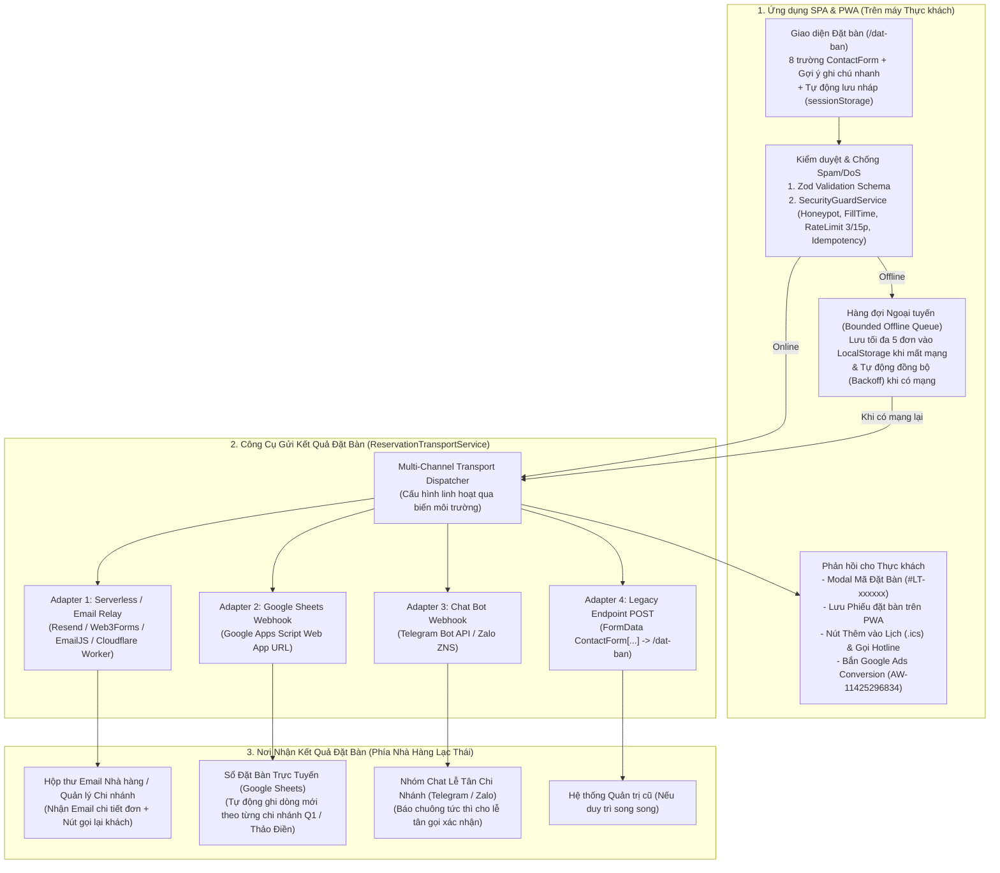

# ADR-009: Kiến Trúc Công Cụ Gửi & Nơi Nhận Kết Quả Đặt Bàn Đa Kênh (End-to-End Reservation Delivery & Notification Architecture)

- **Mã ADR:** `ADR-009`
- **Phiên bản:** `1.0.0`
- **Trạng thái:** `Accepted (Đã chốt: Kết hợp Đa kênh Composite Adapter — Google Sheets + Email Nhà hàng + Phiếu #LT-xxxxxx & Lịch .ics)`
- **Ngày:** `2026-10-17`
- **Liên kết:** `BR v1.3.0` (`FR-06`), `SA v1.3.0` (Mục 4), `SDD v1.3.0`, mở rộng chi tiết cho [`ADR-004`](./ADR-004-data-and-reservation-backend-strategy.md) và [`ADR-007`](./ADR-007-dos-ddos-protection-and-rate-limiting.md)

---

## 1. Bối Cảnh (Context)
Trên website cũ `https://lacthai.vn/dat-ban`, biểu mẫu `<form id="request_qoute_form" action="/dat-ban" method="post">` gửi dữ liệu `ContactForm[...]` về máy chủ PHP 5.6 để xử lý phía server. Khi chuyển sang kiến trúc **SPA & PWA hiện đại**, cần xác định rõ ràng và chi tiết trong Kiến trúc Hệ thống (`SA.md`):
1. **Chi tiết luồng tính năng Đặt bàn** từ lúc khách mở trang đến lúc hoàn tất.
2. **Công cụ kỹ thuật nào** được dùng để gửi dữ liệu đặt bàn từ ứng dụng SPA/PWA đi?
3. **Nơi nhận kết quả đặt bàn ở đâu** (Lễ tân / Quản lý nhà hàng nhận thông tin bằng cách nào, và Thực khách nhận phản hồi ra sao)?

---

## 2. Quyết Định Kiến Trúc (Decision)

Thiết kế hệ thống Đặt bàn theo kiến trúc **Multi-Channel Reservation Dispatcher (`ReservationTransportService`)**, tách bạch giữa **Tầng Kiểm duyệt & Chống DoS tại Client** và **Tầng Công cụ Gửi / Nơi Nhận Kết quả**:

### 2.1. Công Cụ Gửi Kết Quả Đặt Bàn (`Transport Tools`)
Hệ thống cài đặt sẵn giao diện lập trình `ReservationTransportAdapter` hỗ trợ **4 công cụ gửi** (có thể bật 1 hoặc bật kết hợp nhiều công cụ cùng lúc thông qua cấu hình):
1. **Công cụ Email Relay (`EmailWebhookAdapter`):** Gửi payload JSON qua HTTPS POST tới dịch vụ gửi mail (như Cloudflare Worker + Resend / Web3Forms / EmailJS) để chuyển thành email chuẩn HTML gửi thẳng tới hộp thư nhà hàng mà không lộ khóa bí mật.
2. **Công cụ Google Sheets (`GoogleSheetsWebhookAdapter`):** Gửi HTTPS POST tới Google Apps Script Webhook để tự động điền thêm 1 hàng vào bảng tính Google Sheets của nhà hàng.
3. **Công cụ Tin nhắn Tức thì (`InstantNotifyWebhookAdapter`):** Gửi thông báo qua Webhook tới Telegram Bot / Zalo của quầy lễ tân từng chi nhánh (`Mạc Thị Bưởi - Q1` hoặc `Xuân Thủy - Thảo Điền`).
4. **Công cụ Tương thích Ngược (`LegacyPhpFormAdapter`):** Đóng gói đúng định dạng `application/x-www-form-urlencoded` / `FormData` với các khóa `ContactForm[fullname]`, `ContactForm[email]`, `ContactForm[phone]`, `ContactForm[title]`, `ContactForm[date]`, `ContactForm[time]`, `ContactForm[quantity]`, `ContactForm[message]` gửi tới `POST /dat-ban`.

### 2.2. Nơi Nhận Kết Quả Đặt Bàn (`Recipient Destinations`)
1. **Phía Nhà hàng Lạc Thái:**
   - **Nơi nhận 1 (Email Quản lý / Lễ tân):** Nhận email có tiêu đề phân loại sẵn theo chi nhánh, ví dụ: `[ĐẶT BÀN - CN Mạc Thị Bưởi] Nguyễn Văn A - 4 khách - 19:00 20/10/2026`.
   - **Nơi nhận 2 (File Google Sheets Quản lý Đặt bàn):** Bảng dữ liệu trực tuyến lưu toàn bộ lịch sử đặt bàn theo thời gian thực để lễ tân đánh dấu trạng thái *"Đã gọi xác nhận"* / *"Khách đã đến"*.
   - **Nơi nhận 3 (Nhóm Chat Lễ tân Telegram/Zalo):** Thông báo đẩy tức thì trên điện thoại lễ tân trực ca.
2. **Phía Thực khách (Người đặt bàn):**
   - Nhận **Phiếu Xác Nhận Đặt Bàn điện tử (`Reservation Ticket`)** ngay trên màn hình ứng dụng kèm mã tra cứu `#LT-xxxxxx`.
   - Lưu lịch sử phiếu đặt bàn ngay trong ứng dụng PWA (xem lại được cả khi Offline).
   - Nhận Email xác nhận tự động (nếu khách có điền trường `Email`).

## 3. Hệ Quả (Consequences)
- **Tích cực:** Giải quyết triệt để bài toán *"Ai nhận đơn đặt bàn và nhận bằng công cụ gì"* khi bỏ PHP 5.6 cũ; lễ tân nhận thông tin nhanh hơn, không bao giờ thất lạc đơn (nhờ kết hợp Google Sheets + Email/Chat + Offline Queue), và dễ dàng kiểm thử 100% các Adapter bằng TDD.
